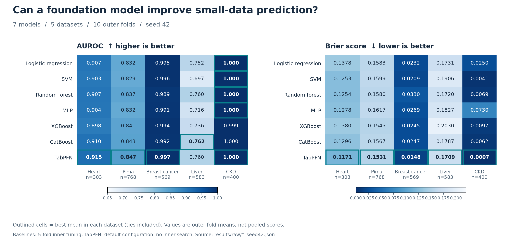
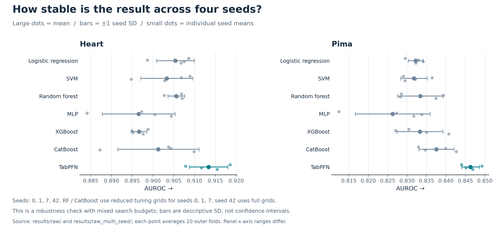

# Clinical Risk Prediction Benchmark

**7 models · 5 small clinical datasets · nested cross-validation**

Independent project by **Jeremy Hsu** — data preparation, model pipelines, experiments, and analysis. Originally developed for NYU DS-GA 1003.

## Objective

**Does a tabular foundation model outperform classical ML when clinical datasets contain only 303–768 samples?** Compare discrimination (AUROC) and probability quality (Brier score), then check stability across seeds.

## Results



**TabPFN has the lowest mean Brier score on 5/5 datasets.** It leads AUROC on Heart, Pima, and Breast Cancer, ties on CKD, and trails CatBoost by 0.0016 on Liver.



**TabPFN retains the highest four-seed mean AUROC on Heart and Pima.** This robustness check mixes search budgets for Random Forest and CatBoost; bars show seed SD, not confidence intervals.

**Scope:** Five retrospective benchmark datasets, with no external clinical validation. Brier score combines calibration and discrimination; TabPFN is not uniformly best by ECE. Across-model Friedman tests give AUROC **p=0.064** and Brier **p=0.022**; these do not establish pairwise TabPFN superiority.

[Raw fold scores](results/raw/) · [Detailed protocol & limitations](docs/benchmark.md) · [Existing analysis figures](figures/)

## Reproduce

```bash
git clone https://github.com/Jeremy891102/Clinical-Risk-Prediction-on-Small-Medical-Datasets.git
cd Clinical-Risk-Prediction-on-Small-Medical-Datasets
python -m venv .venv
source .venv/bin/activate  # Windows: .venv\Scripts\activate
pip install -r requirements.txt

# Render these figures from archived scores; no training or model token required
python scripts/plot_readme_results.py

# Run one baseline experiment
python experiments/run_nested_cv.py --model logistic_regression --dataset heart

# Tests without the licensed TabPFN checkpoint
pytest tests/ -k "not tabpfn"
```

Use Python 3.11/3.12. Full model runs require dataset downloads; TabPFN v2.5 additionally requires a valid Prior Labs license/token and checkpoint access. On macOS, XGBoost may require OpenMP. [More commands and setup details →](docs/benchmark.md#reproduction)
